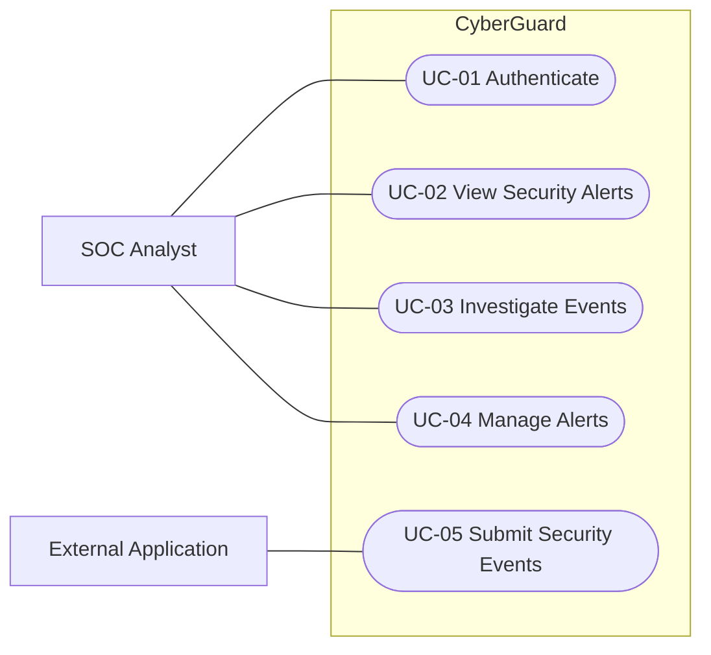

# CyberGuard — Use Case Diagram

## Overview

This diagram illustrates the interactions between the external actors and CyberGuard.

## Diagram

## Actors

- **SOC Analyst:** Monitors alerts and investigates suspicious activities.
- **External Application:** Submits security events for analysis.

## Notes

This Mermaid flowchart is a simplified representation
of the system use cases. A formal UML use case
diagram may be added later.
